# Administrator Manual

This section describes how to use the Visualization Tool from an administrator's perspective.

### Deployment

Everything regarding system requirements, installation, and deployment is described in the main [README](../../README.md) file, in the *Getting started* section.

---

### Building the input data

Each of the dashboards is built from an input CSV file. The following two summarized examples correspond to the input data for dashboards *GitHub Popularity Index* and *GitHub Commit Intensity*, respectively:

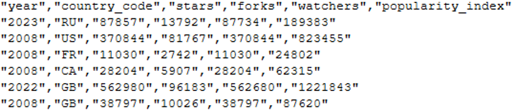

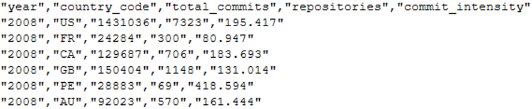

It can be observed that both have the same format and follow the same rules:

- The first row must contain the column names.

- The columns must be separated by **commas**, and not by semicolons or any other character.

- All data—both the column names and the corresponding values—must be enclosed in double quotes.

- For the VT to work correctly, the values ​​in the last column must be numeric.

---

### Workflows

#### Generating a valid API Key

As mentioned in previous sections, a valid API key is required to perform the most sensitive operations. The Visualization Tool includes a local component (*API Key Generator*) to generate it.

To run this module, first open a terminal and navigate to the directory containing it:

```
cd <VT_directory>/osawards.apikeygen.loc
```

If the module is being executed for the first time, dependencies must be resolved beforehand, with *Poetry* acting as the dependency manager responsible for resolving them. To ensure that *Poetry* is installed, enter the command:

```
poetry --version
```

The following message should appear (the version may vary):

        *Poetry (version 1.8.2)*

If it is not installed, run the command:

```
sudo apt install python3-poetry
```

And then install the dependencies:

```
poetry install
```

To generate a valid API key, enter the command:

```
poetry run python api_key_gen.py
```

The command will return the following output:

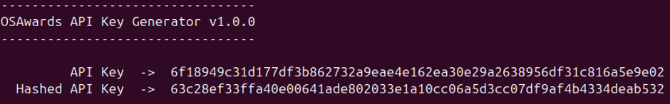

The second result (**Hashed API Key**) must be assigned to the GATEWAY_API_KEY_HASHED property in the .env-gateway environment file. So, once the Gateway API component is deployed, the first result (**API Key**) will be used to call the operations that require it. For example:

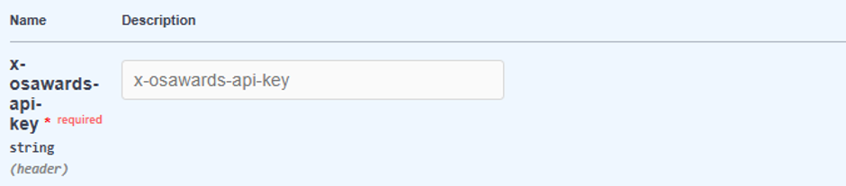

---

#### Checking security and connectivity

Before starting to work with the Visualization Tool, it is recommended to verify connectivity with the Gateway API and the SFTP Server components.

Connectivity with the Gateway API component can be verified by entering the following URL into a browser:

        https://<VT_host>/osawards/api/v1/hello

This response must be received:

```
{"code":200,"error":false,"result":true,"message":"OSAwards Gateway API Version 0.1.0 online!"}
```

To check the SFTP Server connectivity, first access the Gateway API component's Swagger UI interface via the following URL:

        https://<VT_host>/osawards/api/v1/documentation

And expand the ***GET - /hello-server*** operation:

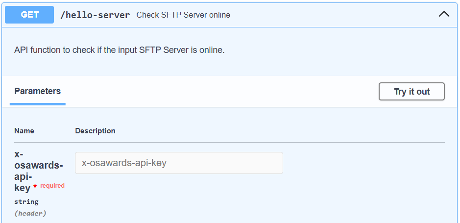

Press the *Try it out* button, enter the API Key, and click on the *Execute* button. If the SFTP Server is up and running, the following response should be displayed:

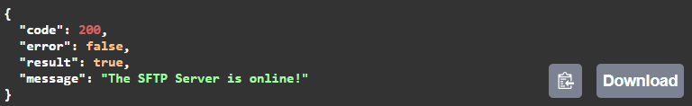

---

#### Workflow in Data Files

The available operations (in the Gateway API component) are the following:

- Retrieve all the stored Data Files.

- Upload a Data File.

- Remove a remote Date File.

- Remove all the remote Data Files.

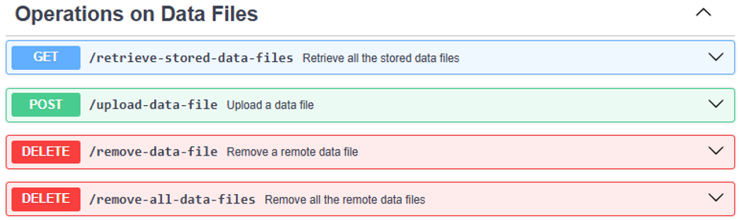

There is a fifth operation in this category: *Execute the data collection process*. It belongs to this group because it is related to Data Files—though not directly; rather, it serves as a "bridge" between Data Files and dashboards and will therefore be described later.

The following subsections describe them in detail.

##### Retrieve all the stored Data Files

First, access the Swagger-UI interface of the Gateway API component:

        https://<*VT_host*>/osawards/api/v1/documentation

And locate the operation: ***GET - /retrieve-stored-data-files***:

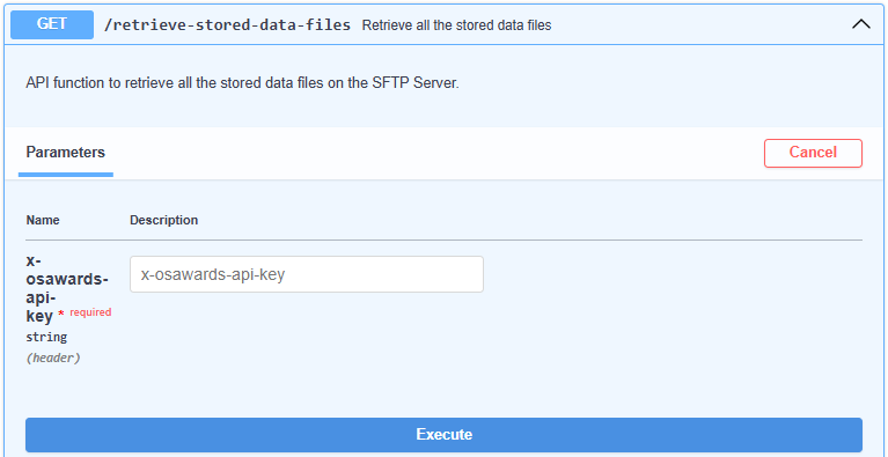

Click on the *Try it out* button, enter the API Key, and click on the *Execute* button. An output like the following should be displayed:

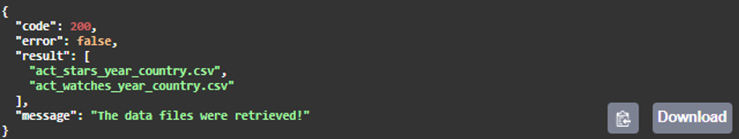

The Data Files located on the SFTP Server will be displayed in the *result* property of
the output JSON.

##### Upload a Data File

To upload a new Data File to the SFTP Server, first access the Swagger-UI interface of the Gateway API component:

        https://<*VT_host*>/osawards/api/v1/documentation

And locate the operation: ***POST - /upload-data-file***:

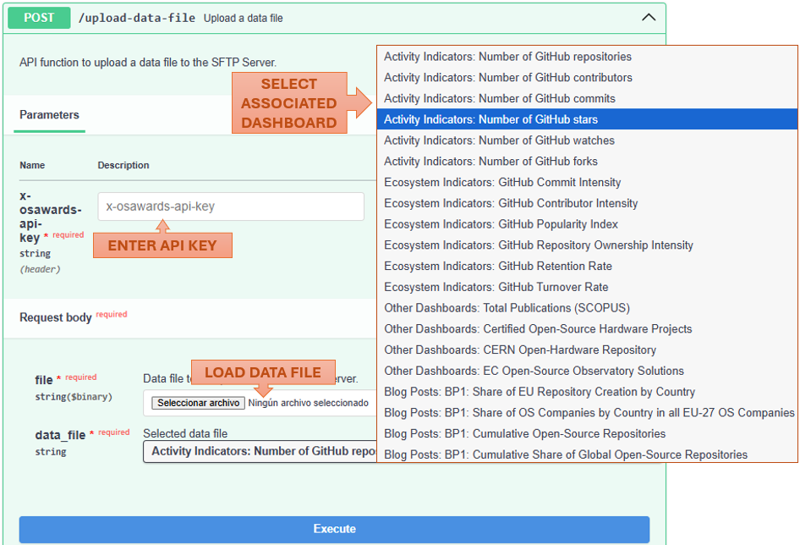

Click on the *Try it out* button, enter the API Key, load the new Data File, and finally select the file type in the list. An output like the following should be displayed:

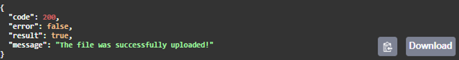

##### Remove a remote Data File

To remove a remote Data File, access the Swagger-UI interface of the Gateway API component:

        https://<*VT_host*>/osawards/api/v1/documentation

And locate the operation: ***DELETE - /remove-data-file***:

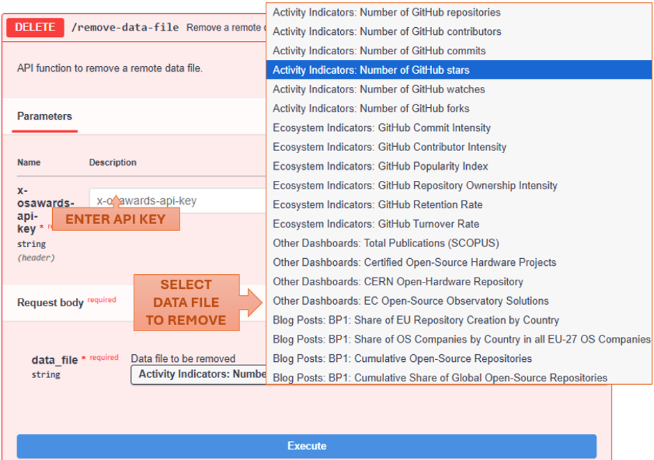

After entering the API Key, click on the *Try it out* button, select the Data File to be removed, and then click on the *Execute* button. If the file has been found, an output like the following should be displayed:

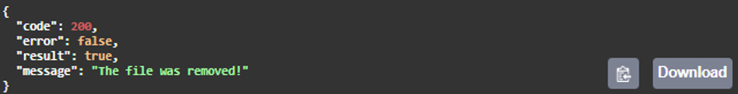

##### Remove all the remote Data Files

To remove all the existing remote Data Files, access the Swagger-UI interface of the Gateway API component:

        https://<*VT_host*>/osawards/api/v1/documentation

And locate the operation: ***DELETE - /remove-all-data-files***:

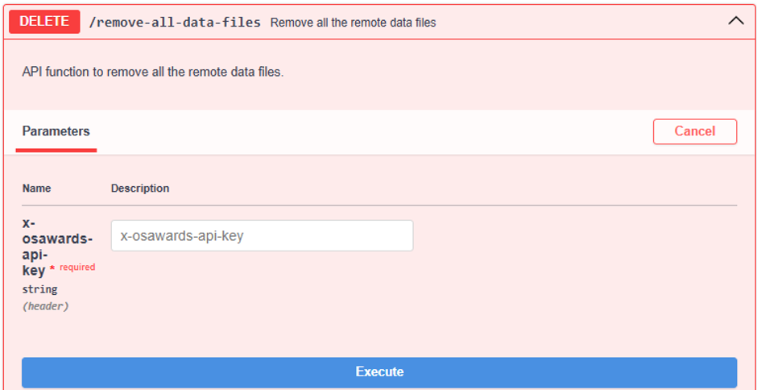

After entering the API Key, click on the *Try it out* button, and then click on the *Execute* button. An output like the following should be displayed:

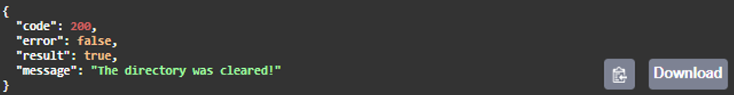

---

#### Workflow on Dashboards

##### Creating a new dashboard

To detail the workflow for creating a new dashboard, a prepared Data File is used as the starting point. An example of summarized content could be the following:

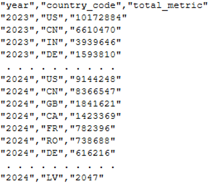

This file does not correspond to any previously registered dashboard. Therefore, the first step is to register the type of the dashboard, and associate it to an existing category, in the Gateway API component code. To do that, edit the code in the file:

```
osawards.gateway.dck/model/metric_model.py
```

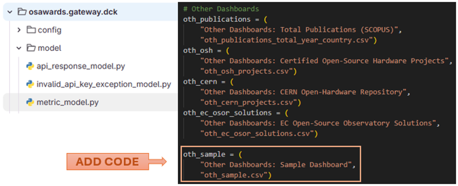

After redeploying the Gateway API component, the next step consists of creating the dashboard template on the SFTP Server. This template defines the three elements of a
chart:

- Index pattern element.

- Visualization element.

- Dashboard element.

The best way to create the template is by making a copy of an existing one in the directory:

```
osawards.sftp.dck/templates
```

And rename the copy as *oth_sample.json*, since the template name must match the name of the CSV file assigned when registering the dashboard type in the previous step:

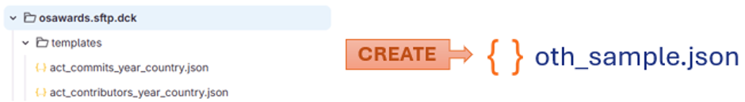

A template has four distinct parts:

- Mappings.

- Index pattern.

- Visualization.

- Dashboard.

Open the template and edit the first part (mappings):

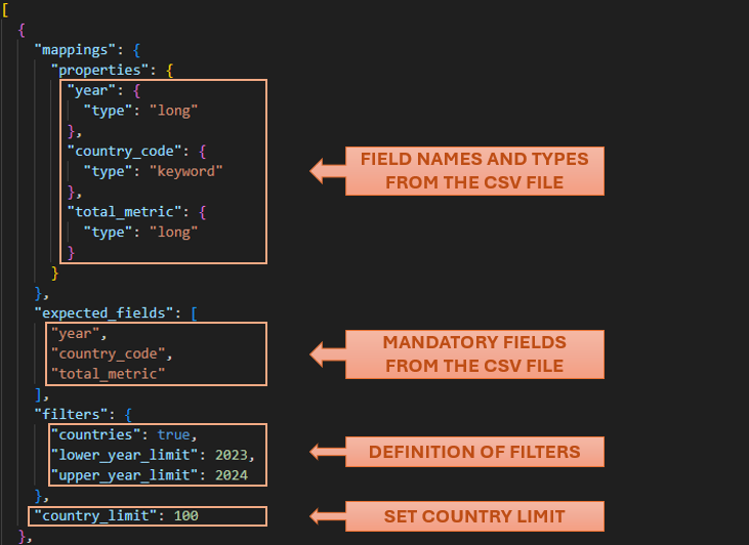

Next, edit the second part (index pattern), bearing in mind that the title must be the CSV filename plus the "*_index*" suffix:

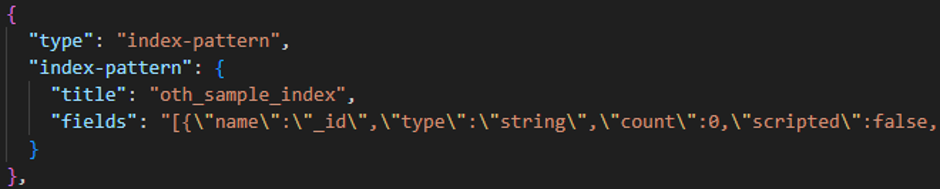

The fields from the CSV file must be included in this definition. Additionally, regarding the *country code*, a *country* field must be included to make the *country name* available.

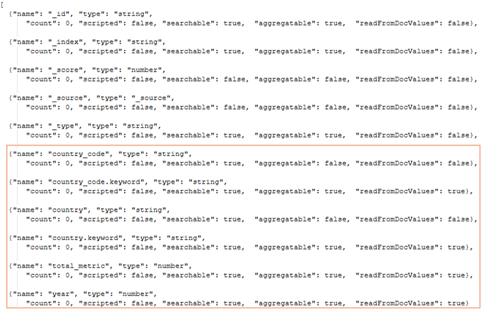

Save the template and redeploy the SFTP Server component.

The next step is to publish this index pattern in GrimoireLab. To do this, the Data Collector component will be used. However, before launching it, its code must be edited so that it publishes only the index pattern, leaving the visualization and dashboard for the final step. Open the file:

```
osawards.datacollector.dck/datacollector.py
```

Comment out the following lines and redeploy the component:

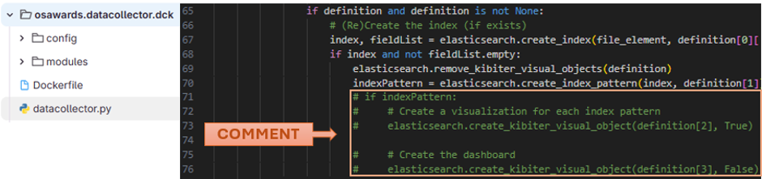

Once done, use the Gateway API to upload the CSV file:

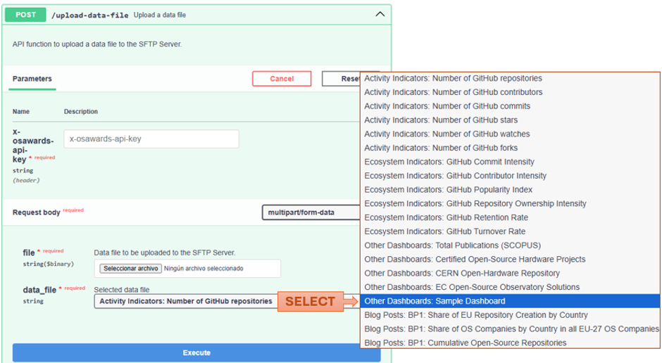

And execute the Data Collector using the operation: ***GET - /execute-data-collection***:

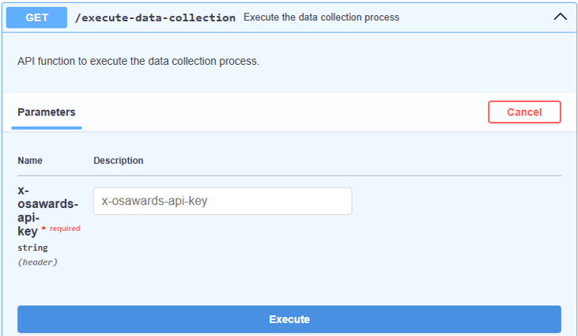

To check the result, access GrimoireLab entering the following URL into a browser:

        https://<*VT_host*>

In the left-hand menu, click the last button *Management*, click on *Saved Objects*, and search for the recently created index pattern, whose name must be *oth_sample_index*.

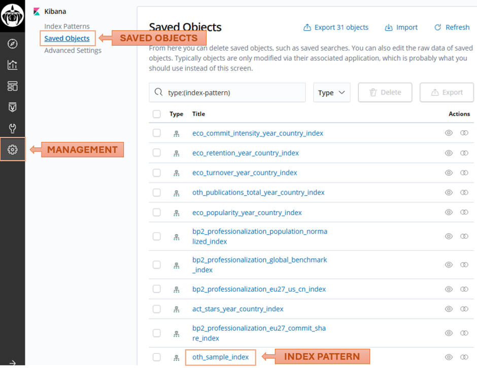

The next step is to create manually the visualization and the dashboard in GrimoireLab. And once they have been created, the definition generated by GrimoireLab for both elements will be used to update the dashboard template.

In the left-hand menu, click the second button *Visualize*, then click the *Add* button, and select a visualization type (for example, *Line*):

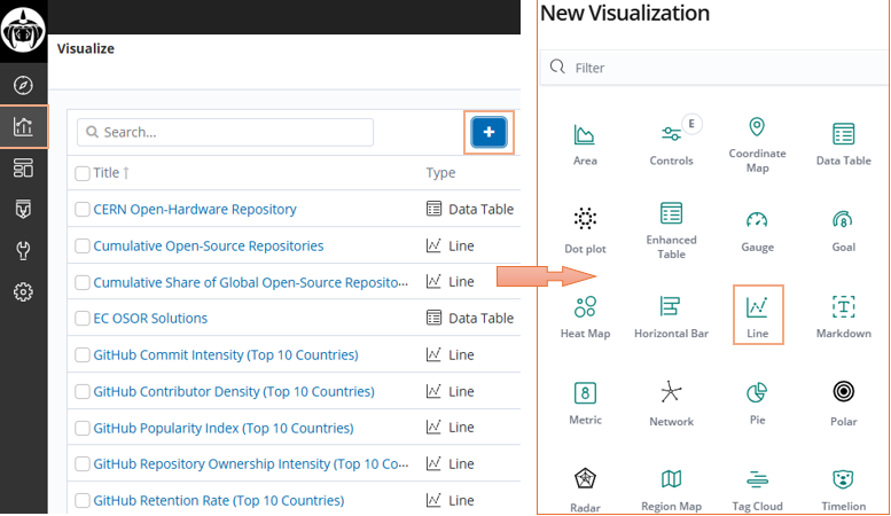

In the left panel, combine the data as desired for each axis of the chart. In the left panel, combine the data as desired for each chart axis. When finished, click the *Save* option in the top menu. For example:

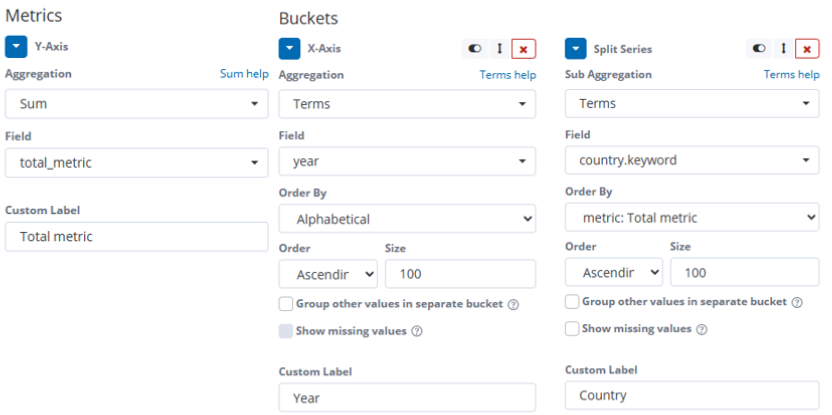

Next, create the dashboard element by clicking the *Dashboard* button in the left-hand side menu, followed by the *Create new dashboard* button:

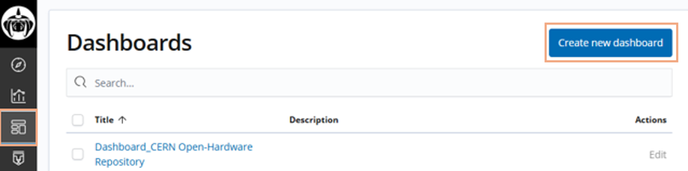

On the screen that appears, click the *Add* button, select the recently created visualization, and finally click the *Save* option in the top menu:

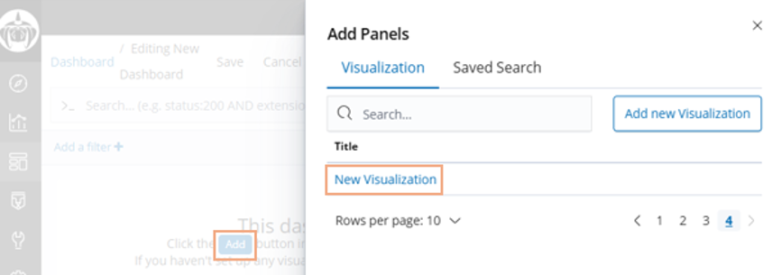

The next step is to obtain the "*definitions*" that GrimoireLab applies to the visualization and dashboard elements. To do this, in the left-hand menu click the last button *Management*, click on *Saved Objects*, search for the visualization and dashboard elements, and click on them.

Transfer the content of the following figures to the dashboard template, taking care to escape the double quotes , changing the titles of both elements and replacing the visualization *Id* (use the title) in the section defining the dashboard.

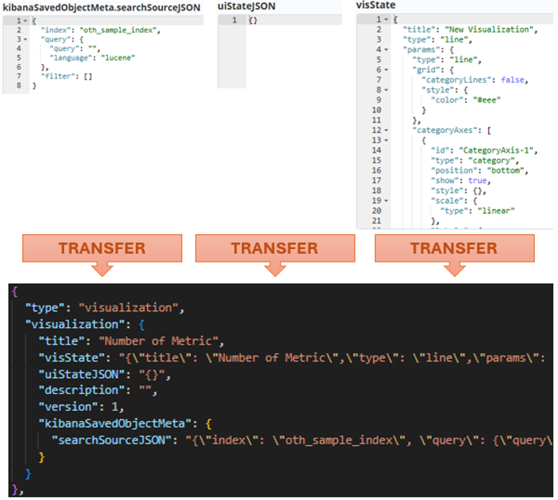

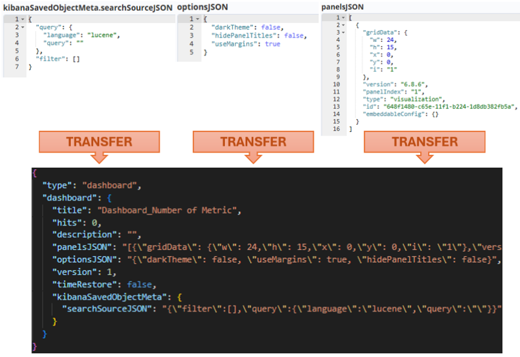

Finally, uncomment the previously commented-out lines in the Data Collector component, redeploy it, and execute again the operation: ***GET - /execute-data-collection***.

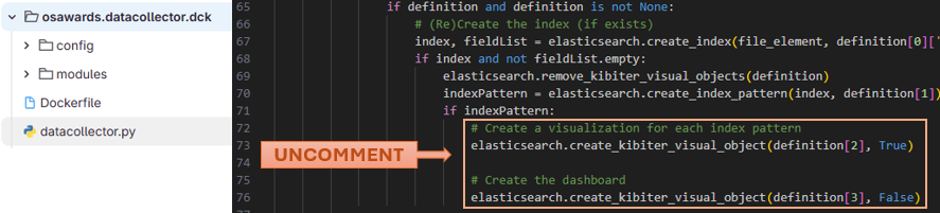

---

##### Updating an existing dashboard

This subsection describes how to update an existing dashboard with a renewed Data File, which may include updated information on countries, time periods, etc. The procedure is very simple: the new Data File simply needs to be uploaded and associated with the corresponding dashboard.

To do that, first access the Gateway API component's Swagger UI interface via the following URL:

        https://<*VT_host*>/osawards/api/v1/documentation

And expand the operation: ***POST - /upload-data-file***. Then, after clicking on the *Try it out* button, enter the API Key, load the Data File, and finally select the associated dashboard in the list:

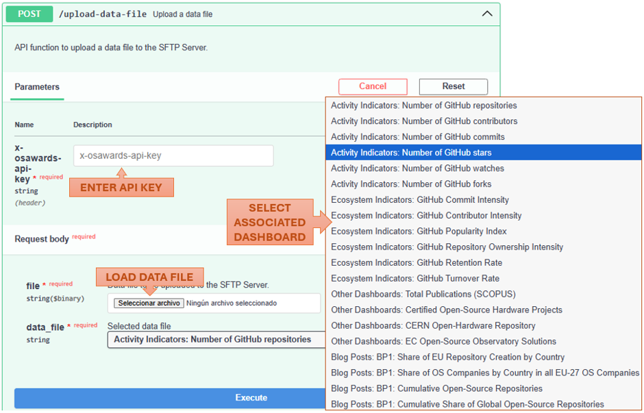

Click on the *Execute* button. If everything went well and the response code was 200-OK, expand the operation: ***GET - /execute-data-collection***. And as with the other operations, click the *Try it out* button, enter the API Key, and click the *Execute* button.

The dashboard will be rebuilt using the new data.

---

#### Workflow on User Stories

Before describing the operations that can be performed on User Stories, it is worth mentioning the structure of each one:

- **Id**: the unique identifier of each User Story.

- **Date**: the date of publication.

- **Description**: a brief description of the content.

- **Link**: the direct link to the content.

The available operations (in the Gateway API component) act upon this structure, and are as follows:

- Retrieve all the User Stories.

- Add a new User Story.

- Remove an existing User Story.

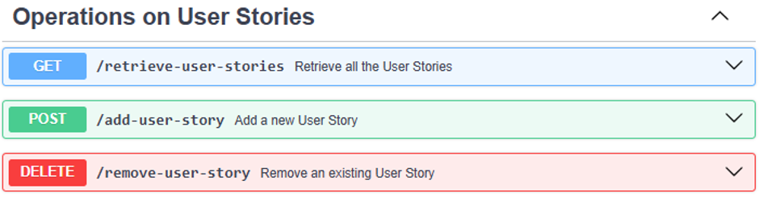

The following subsections describe them in detail.

##### Retrieve all the User Stories

First, access the Swagger-UI interface of the Gateway API component:

        https://<*VT_host*>/osawards/api/v1/documentation

And locate the operation: ***GET - /retrieve-user-stories***:

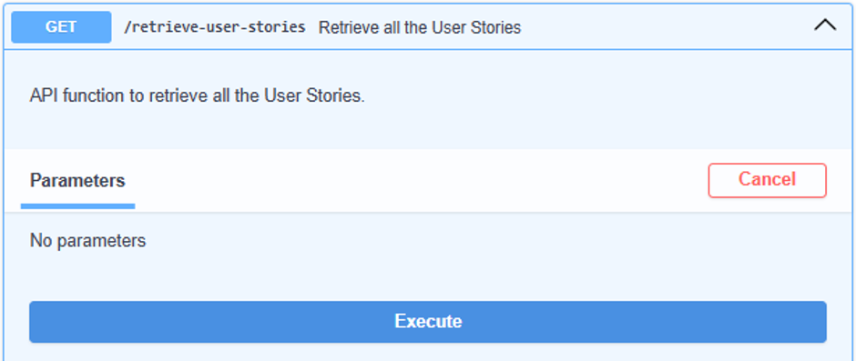

Click on the *Try it out* button, and then click on the *Execute* button. An output like the following should be displayed:

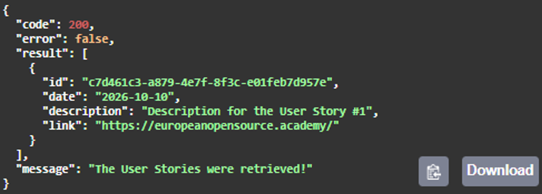

##### Add a new User Story

To add a new User Story, first access the Swagger-UI interface of the Gateway API component:

        https://<*VT_host*>/osawards/api/v1/documentation

And locate the operation: ***POST - /add-user-story***:

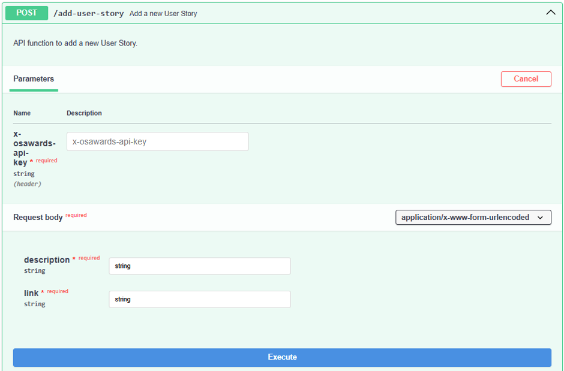

After entering the API Key and fill in the *Description* and *Link* required fields, click on the *Try it out* button, and then click on the *Execute* button. An output like the following should be displayed:

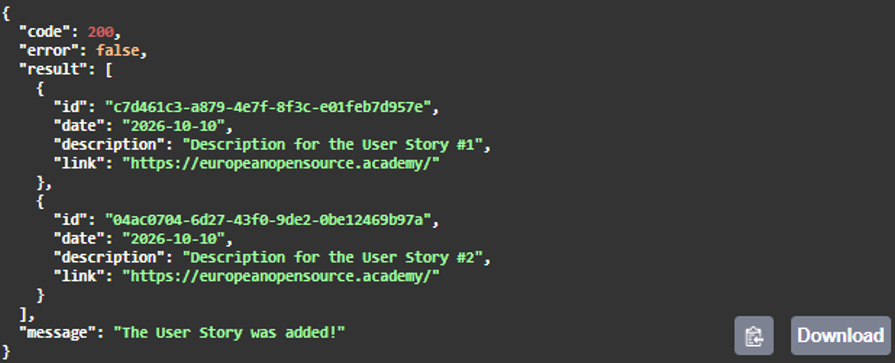

##### Remove an existing User Story

To remove an existing User Story, it is necessary to know the *Id* of the story to be
deleted. This *Id* can be obtained by first executing the *Retreve all the User Stories* operation. Access the Swagger-UI interface of the Gateway API component:

        https://<*VT_host*>/osawards/api/v1/documentation

And retrieve all the stories, as specified in the subsection dedicated to this operation.

Next, locate the operation: ***DELETE - /remove-user-story***:

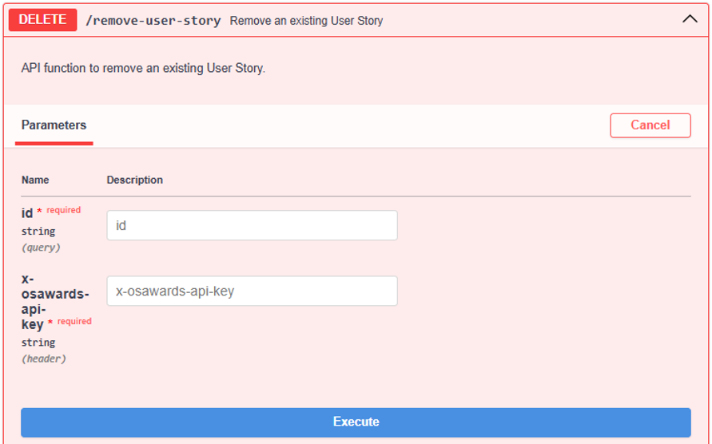

After entering the API Key and fill in the *Id* required field, click on the *Try it out* button, and then click on the *Execute* button. An output like the following should be displayed:

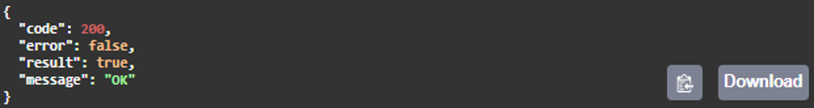

---

#### Workflow on Reports

As described in the User Stories, let us first mention the structure of a Report entity:

- **Id**: the unique identifier of each Report.

- **Date**: the date of publication.

- **Title**: a text to give a title to the Report.

- **Description**: a brief description of the content.

- **Link**: the direct link to the content.

And as is also the case with User Stories, three identical operations have been defined for Reports:

- Retrieve all the Reports.

- Add a new Report.

- Remove an existing Report.

Due to their similarity to User Stories, this section will not describe how to execute the operations: instead, follow the steps from the previous section.

---

### Using GrimoireLab

For a Visualization Tool Administrator, the most relevant uses of GrimoireLab are described in subsection "*Creating a new dashboard*". To summarize, the following figure shows the main options that should be considered:

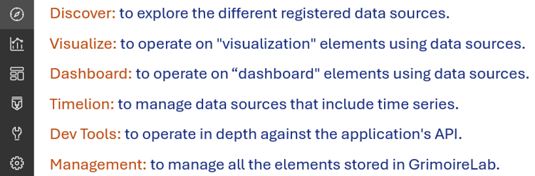

---

### Using the User Interface

The User Interface does not offer any administration features. All details regarding its use are provided in the *[User Manual](../user_manual/README.md)* section.

In terms of development, this component is a static web page—meaning it uses HTML, CSS, and JavaScript technologies without relying on any server-side technology. The following figure shows the directory tree in which the User Interface code is structured:

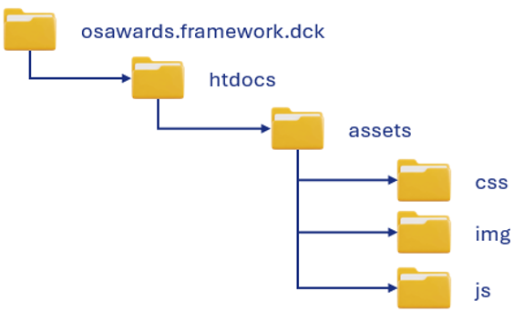

#### Contents of the "htdocs" directory

This directory contains all the HTML files corresponding to each published dashboard and their category-based overviews. The prefix of each filename indicates which category it belongs to:

- **Prefix *index_***: it represents the overview of a category.

- **Prefix act_**: it represents the dashboards in the *Activity Indicators* category.

- **Prefix eco_**: it represents the dashboards in the *Ecosystem Indicators* category.

- **Prefix oth_**: it represents the dashboards in the *Other Dashboards* category.

- **Other**: files without a distinct prefix refer to HTML files linked from other
  applications.

#### Contents of the "assets/css" directory

This directory contains all the applied style sheets. The User Interface-specific CSS is the *vt.css* file. The others belong to the Bootstrap framework and other stylesheets
inherited from the EOSA website.

#### Contents of the "assets/img" directory

This directory contains all the images used in the application: logos, icons, and an
identifying image for each published dashboard.

#### Contents of the "assets/js" directory

This directory contains the scripts required for the application to function. Specifically, the scripts belonging to the Bootstrap framework, the scripts inherited from the EOSA website, and a script file specific to the Visualization Tool: *vt.js*.

This file essentially includes the mechanisms for loading data for the drop-down lists, as well as the definition and application of filters for each dashboard.