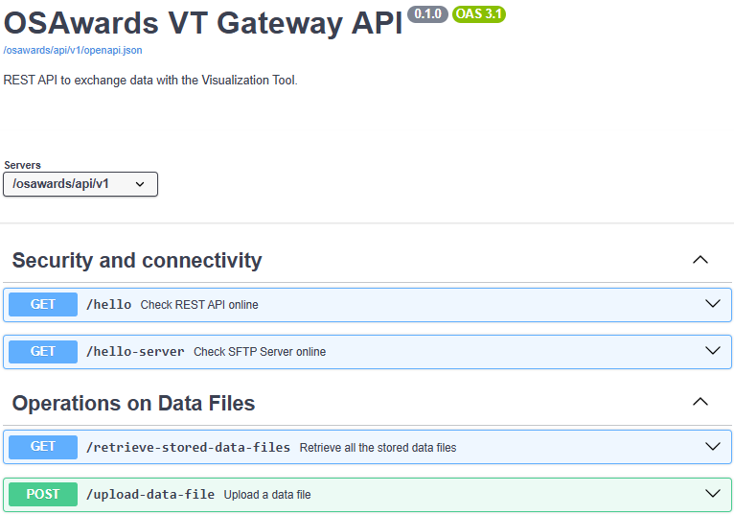
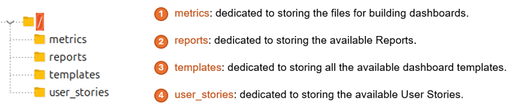
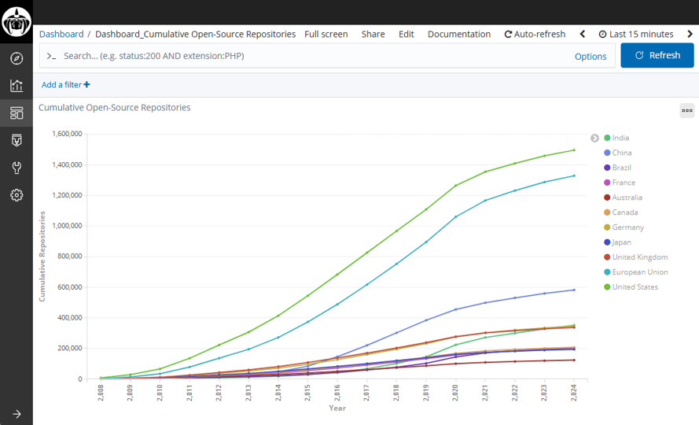
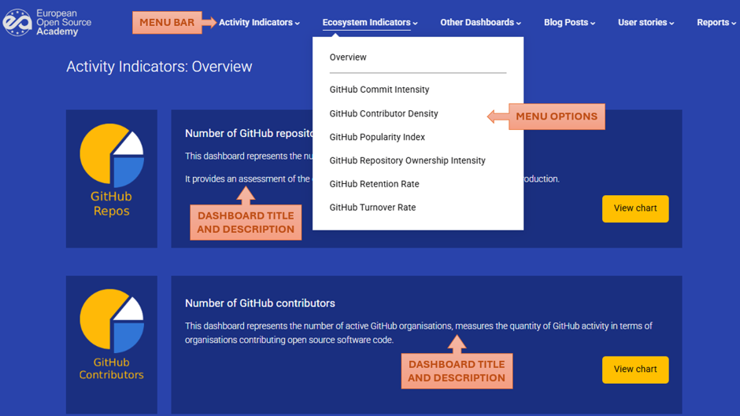
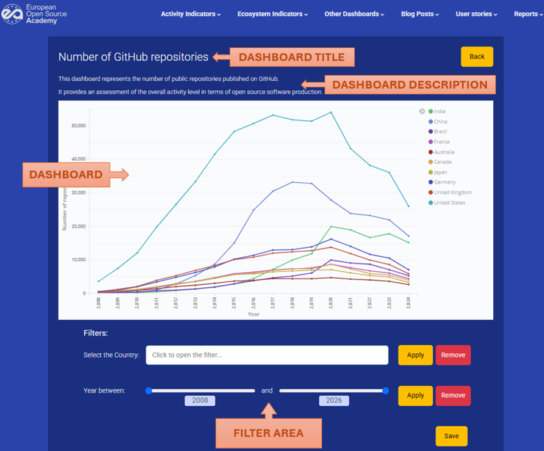
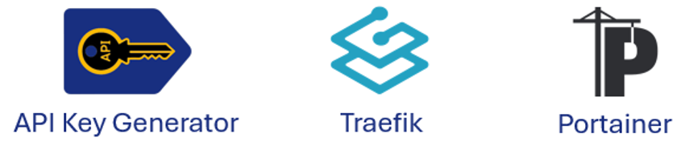
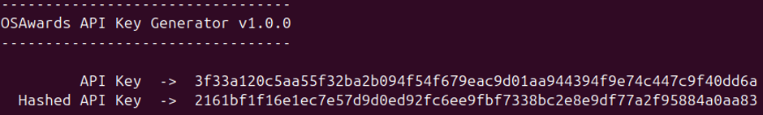
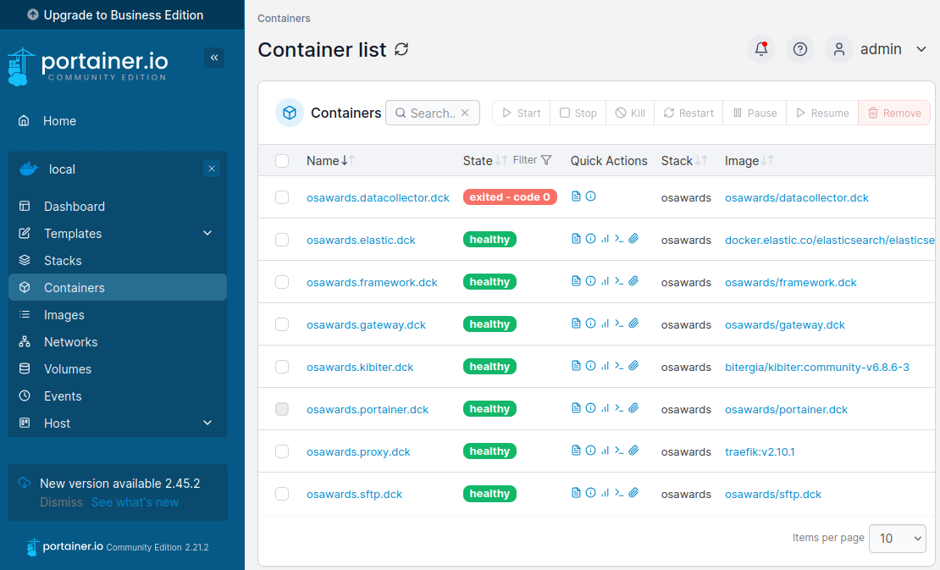

# Visualization Tool Modules

### Gateway API

The Gateway API provides external administration access to the Visualization Tool, and
offers:

- Operations on Dashboards from Data Files, External Sources, User Stories and Reports.

- Integration with other components or tools.

The different operations are grouped into five categories:

- **Security and connectivity**: check the status of the Gateway API and SFTP Server components.

- **Operations on Data Files**: retrieve, upload and remove Data Files with information on indicators, and call the Data Collector component.

- **Operations on External Sources:** retrieve the projects and solutions from
  external repositories or catalogs.

- **Operations on User Stories**: retrieve, add and remove.

- **Operations on Reports**: retrieve, add and remove.

To operate the different functions exposed, the Gateway API component offers a Swagger-UI interface:

The most sensitive operations are protected with an API Key, to provide the Visualization Tool with a minimum level of security. This API key must be generated by the *API Key Generator* module for each deployment.

---

### SFTP Server

This component provides the storage space for all the necessary data of the Visualization Tool. The following figure details the server's directory tree and the purpose of each directory:

Only the Gateway API component accesses the SFTP Server content. Any other component (basically the Data Collector component and the User Interface) wishing to access this content must first call the Gateway API.

---

### Data Collector

The Data Collector component retrieves all the data and template files from the SFTP Server and processes them following the steps:

- Apply filters to the data.

- Normalize the resulting data.

- Load and use the appropriate template to build the final dashboard.

- Create all the dashboard elements in the GrimoireLab component.

The input Data Files must be in CSV format and must follow some specific rules, which will be described in subsequent sections.

---

### GrimoireLab

This component consists of a fork of Kibana, and supported by an Elasticsearch,
developed by Bitergia, and its main objective is to store the different dashboards
displayed on the Visualization Tool.

A dashboard in GrimoireLab is composed of three elements:

- **Index pattern element**: each input Data File is translated into a tabular index.

- **Visualization element**: the data table is transferred to a configurable chart type.

- **Dashboard element**: it encloses a Visualization element, also allowing some extra configurations.

The **Visualization** and **Dashboard** elements generate their own URLs, which include the location and the filters applied to each element. This URL is used to access the visualization of each chart, defining it as the source of an iframe within a dedicated HTML file.

---

### User Interface

This component corresponds to the Visualization Tool frontend: a static website to display and operate all existing dashboards, User Stories and Reports.

All available Dashboards embedded in GrimoireLab can be viewed. In addition, it also features custom filters for a better user experience.

The following figures show, respectively, an overview of the user interface and a detailed view of a dashboard display screen.

---

### Additional components

The Visualization Tool incorporates three extra components that, while not part of the tool's workflow, provide useful or necessary additional functionalities. These components are:

#### API Key Generator

The API Key Generator component has been developed to provide the Gateway API component with a minimal security key for performing the most sensitive operations.

This module is designed to run locally, without a server, and not containerized with Docker. When executed, the API Key Generator returns two results:

- An **API Key**: the key to be used to call the sensitive functions.

- A **hashed API Key**: the encrypted key against which the correspondence with the first key is compared.

The encrypted key will be part of the Gateway API component configuration. The method for doing this is described in greater detail in subsequent sections.

#### Traefik

Traefik is a modern, lightweight reverse proxy that is particularly popular in container and microservices application environments.

Its primary function is to act as a single-entr point for one or more applications, receiving HTTP/HTTPS requests and routing them to the appropriate service.

This is precisely its role in the Visualization Tool: to offer a single-entry point and provide encrypted communications via the HTTPS protocol.

#### Portainer

Portainer is a container management platform that provides a graphical user interface to easily and visually manage Docker, Swarm, Kubernetes, and other orchestrator environments.

Its primary function is to act as a control panel for container platforms, allowing users to manage their services, images, volumes, networks, secrets, and logs without having to rely exclusively on the command line.

