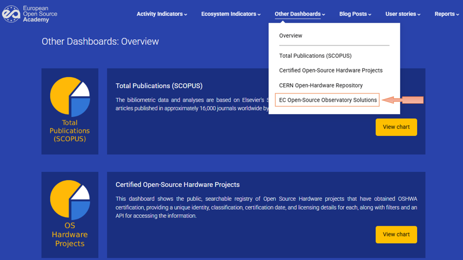
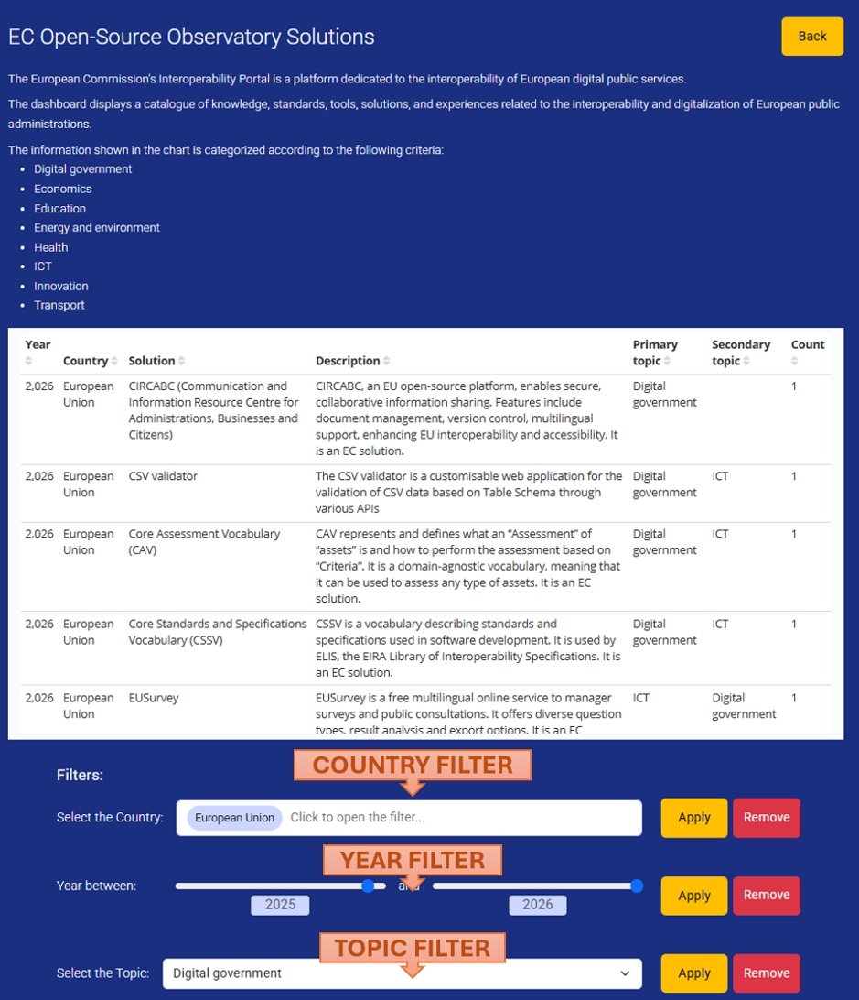
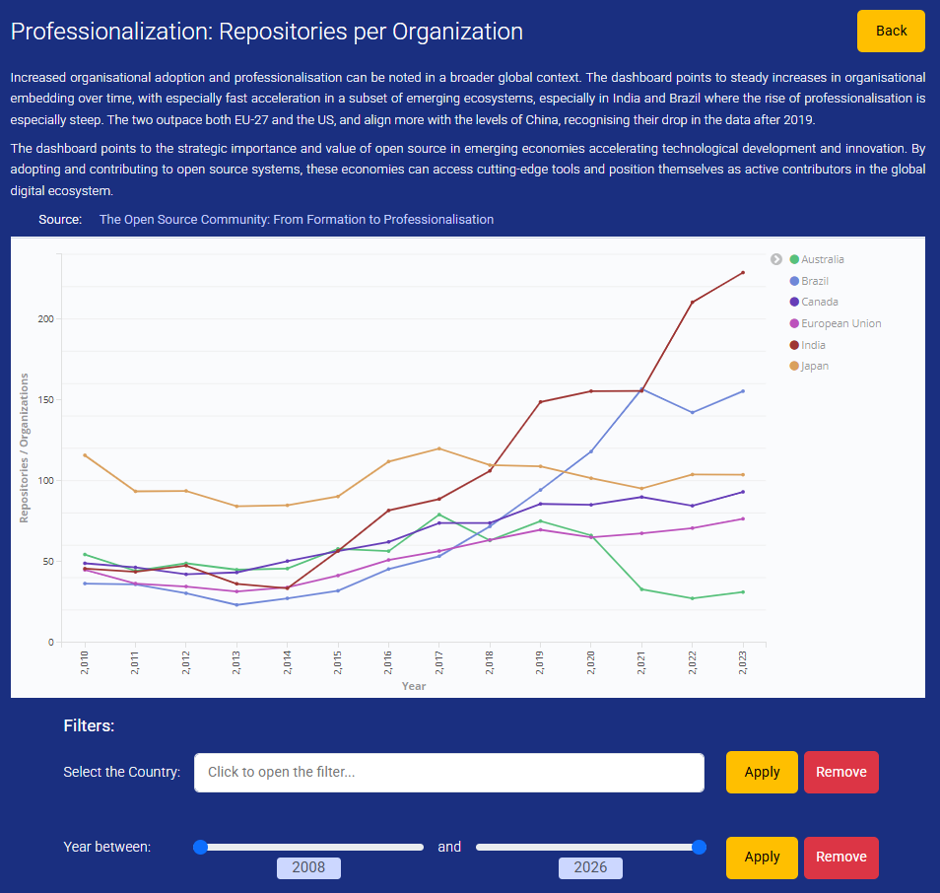
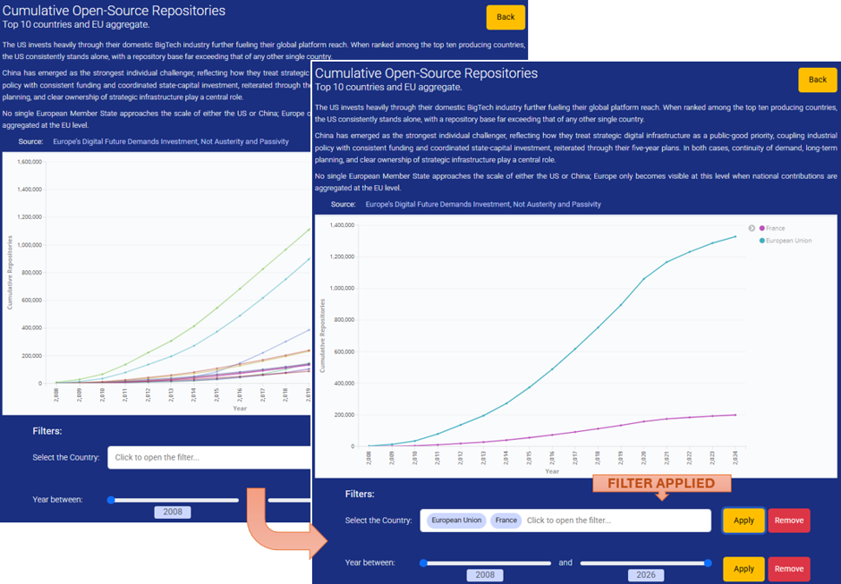
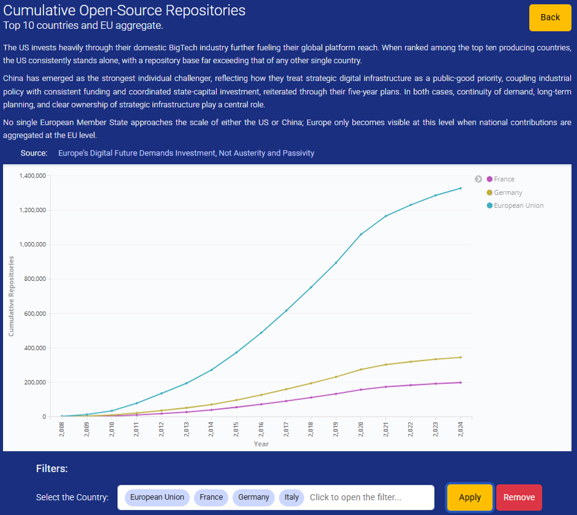

# Examples of Use Cases

### Scenario 1

###### INTRODUCTION

*As an analyst of OS evolution in the digital government of the European Union,  I want to know about the EC Open-Source Solutions in the European Union during this year (2026) and see if there is a significant increase of this solutions meaning there is an increase on the investment and interest by the administrations. I am interested on the “Digital Government” topic.*

###### FIRST STEP

*Select the “EC Open-Source Observatory Solution” dashboard:*

###### SECOND STEP

*Change the filters to see the information about the European Union and year 2025 to 2026 with topic “Digital Government”:*

*The EU has registered 6 different solutions in 2026 with a primary topic of Digital government, and another solution indicated the same topic as secondary. Considering that during last year EU had a unique solution related this topic, it is clear that Europe is
putting faith in the Open Source solutions when is related to the Digital Government as an important part of the European sovereignty.* 

*I will research about the funding that the EU provided to the different countries and see if there is a relationship between those fundings and the increase of the solutions in 2026 that the dashboard shows (other European sources).*

---

### Scenario 2

###### INTRODUCTION

*As a person interested in Open Source, who heard about the EOSA web in the news or surfing the www, I am reading the article:*

###### FIRST STEP

*I selected the source material for the “Professionalisation: Repositories per organisation” figure:*

###### SECOND STEP

*Out of curiosity, I would like to see more information, so I accessed to the list of the VT
dashboards and selected the “Cumulative Open-Source Repositories” because I am
French and I would like to know more about the repositories in my country. And
I want to have a clear comparison with the EU repositories, so I use the
filters:*

###### THIRD STEP

*I see that difference is big, but I would like to compare also with Germany as other important country in the EU and see its numbers:*

*And I see Germany has more repositories than France, but it is far from the aggregated number of the EU, so I feel better.*