# User Manual

This manual describes how to use the Visualization Tool from the perspective of the general public.

The Visualization Tool is accessed via the User Interface, which has the following general appearance:

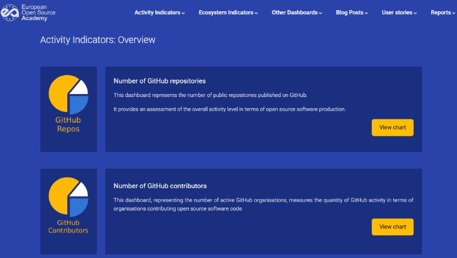

The top menu bar provides access to the Visualization Tool’s features, and contains the
following entries:

- **Activity Indicators**: access to the dashboards implemented for the visualization of indicators related to repository activity, such as the number of commits, forks, stars...

- **Ecosystem Indicators**: access to the dashboards implemented for the visualization of indicators related to the adoption, impact, and sustainability of open source and indicators.

- **Other Dashboards**: access to the dashboards implemented for the visualization of indicators related to repositories and catalogs other than GitHub.

- **Blog Posts**: access to the dashboards implemented for supporting the published blog posts.

- **User stories**: access to the stories contributed by users.

- **Reports**: access to the available reports.

### Using the top menu bar

The *Activitiy Indicators*, *Ecosystem Indicators*, *Other Dashboards* and *Blog Posts* entries have have two groups of options:

- An *Overview* entry to display the list of dashboards available in the category.

- A single entry to access each of the dashboards.

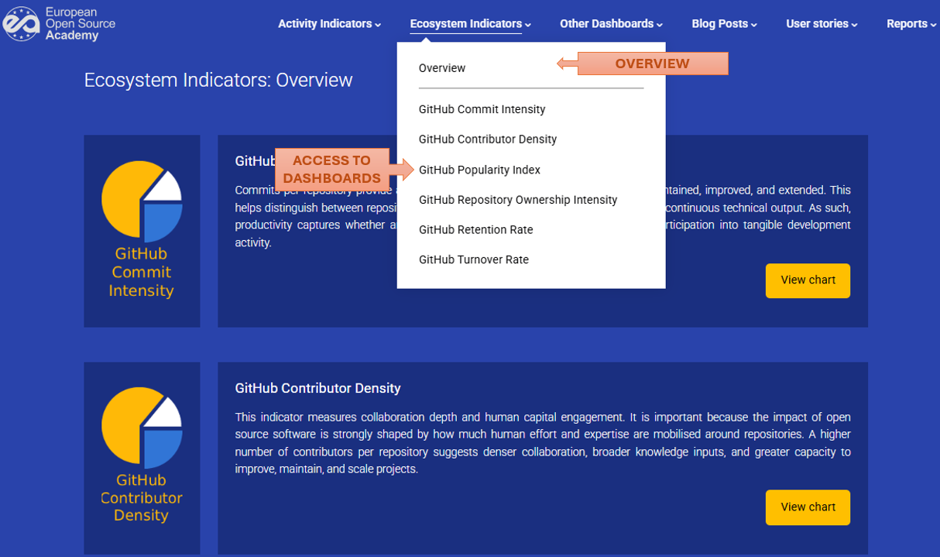

The User stories and Reports entries are simpler, and there is only one option for displaying their content.

### Using Dashboards

All dashboard display screens have the following appearance:

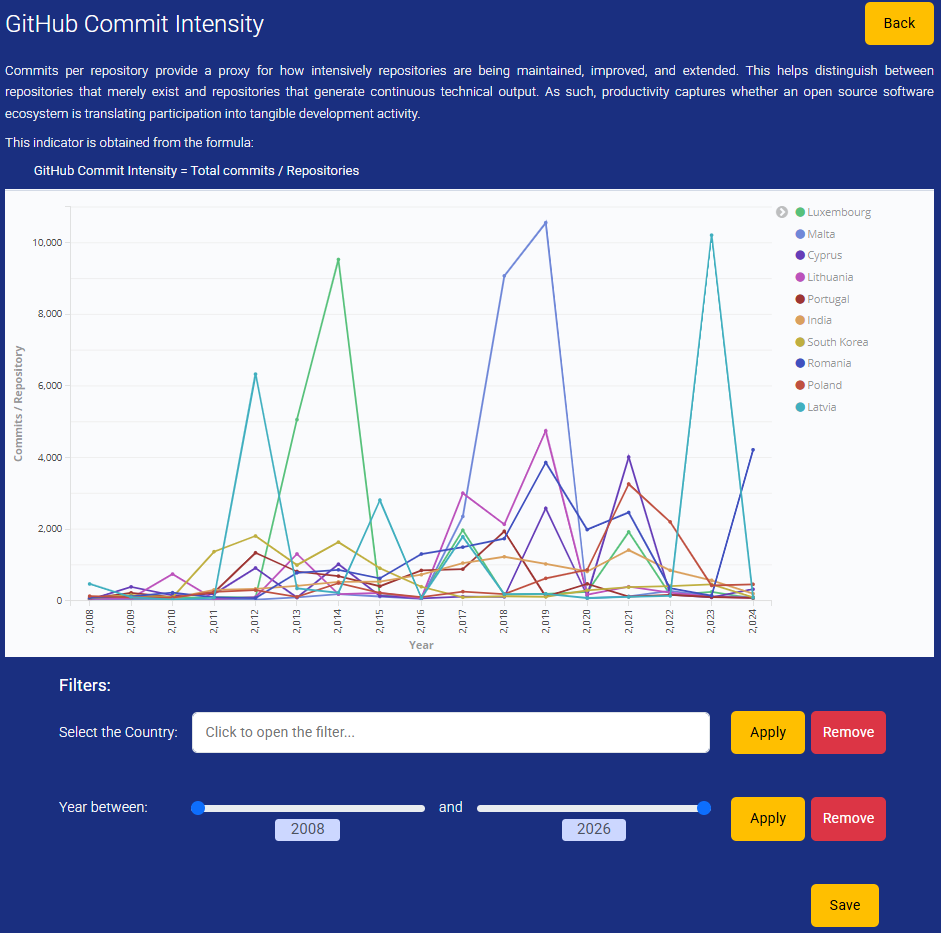

And all the screens display the elements:

- A title and a descriptive text.

- The data area.

- A filter area.

- Other actions.

The "Title and descriptive text area" contains the title of the dashboard, and a brief descriptive information about what is being displayed:

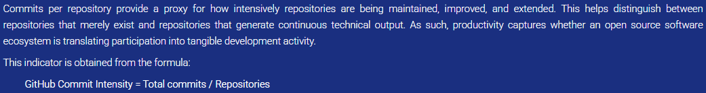

The "Data area" constains the chart associated with the data to be displayed:

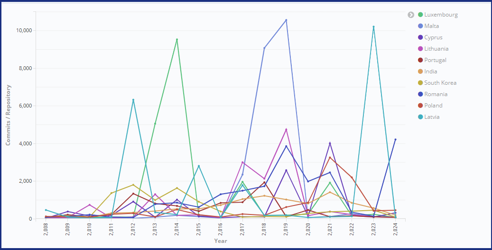

Regarding the "Filter area", depending on the data being viewed, the tool presents a series of filters to narrow down the information displayed. The following figure shows a filter by country and another by year:

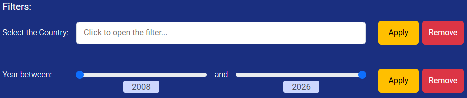

### Filtering data

the data displayed on a dashboard can be filtered to narrow down the view. And depending on the chart type, the Visualization Tool will display the filters most suitable for each one. The following filters are available:

| Filter name                | Frequency | Included in   |
| -------------------------- | --------- | ------------- |
| Filter by Country          | High      | 15 dashboards |
| Filter by Year             | High      | 15 dashboards |
| Filter by Project Type     | Low       | 1 dashboard   |
| Filter by Hardware License | Low       | 1 dashboard   |
| Filter by Software License | Low       | 1 dashboard   |
| Filter by Topic            | Low       | 1 dashboard   |

##### Filtering by Country

To filter by country, click on the filter input to expand the list of countries by which the results can be narrowed down. And once the list is open, clicking on the **[X]** in the top-right corner closes it:

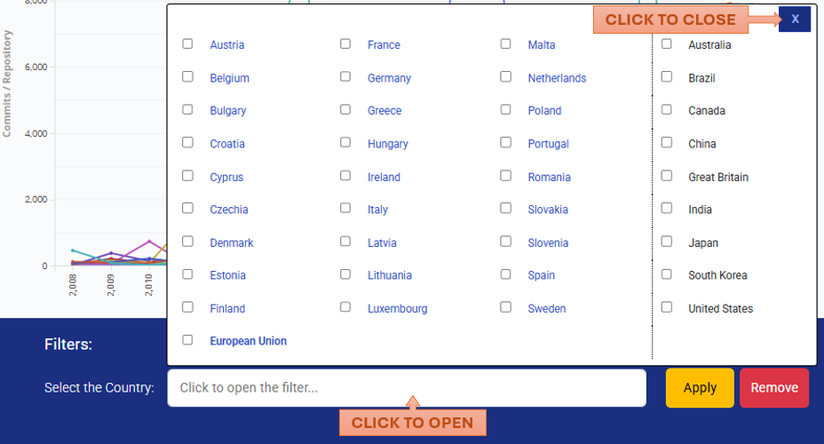

To apply the filter, select the desired countries and click the *Apply* button:

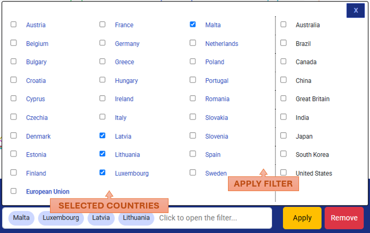

The result is immediately visible:

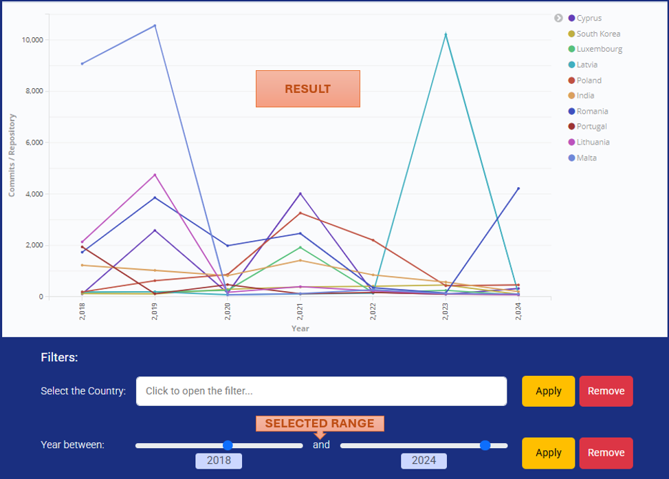

To update the filter, simply repeat the process: re-expand the list of countries, select the desired ones, and click the *Apply* button again.

Finally, to clean the filter just click the *Remove* button.

##### Filtering by Year

To establish the filter for a year range, select the lower and upper limits using the sliders:

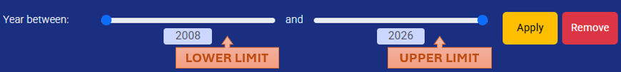

The minimum lower limit corresponds to the year 2008, and the maximum upper limit corresponds to the year 2026.

Once the range is selected, click on the *Apply* button and view the result. For example, for a range between 2018 and 2024, the result is:

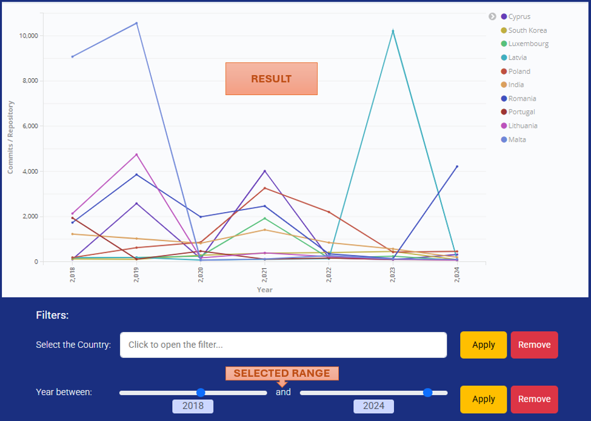

Finally, and as in the previous case, to clean the filter just click the *Remove* button.

##### Filtering by Project Type

This filter allows to select a project type from a drop-down list and view the result on a data table dashboard. The following table contains the project types defined in the only dashboard that includes this type of filter to date:

- 3D Printing

- Agriculture

- Arts

- Education

- Electronics

- Enclosure

- Environmental

- Home Connection

- IOT 

- Manufacturing

- Other

- Robotics

- Science

- Sound

- Space

- Tool

- Wearables

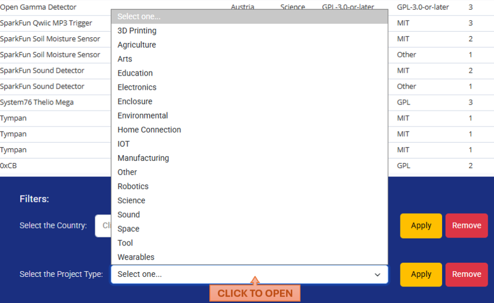

For example, by selecting the *IOT* project type, and clicking the *Apply* button:

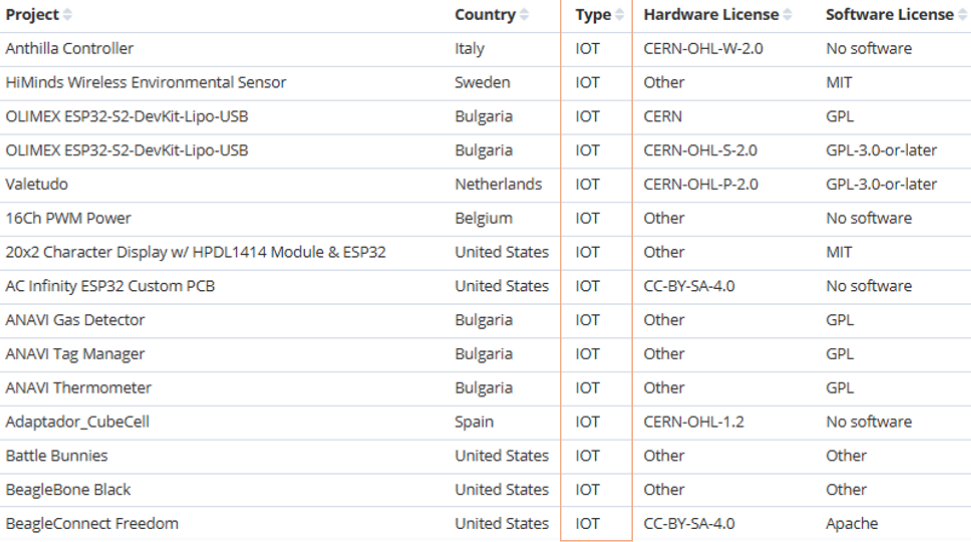

Finally, and as in the previous cases, to clean the filter just click the *Remove* button.

##### Filtering by Hardware License

This filter allows to select a hardware license from a drop-down list and view the result on a data table dashboard. The following table contains all the available hardware licenses:

- CC-BY-4.0

- CC-BY-SA-4.0

- CC0-1.0
  CERN

- CERN-OHL-1.2

- CERN-OHL-P-2.0

- CERN-OHL-S-2.0

- CERN-OHL-W-2.0

- GPL
  GPL-3.0-only

- GPL-3.0-or-later

- MIT

- Other

- Solderpad

- TAPR

Again, the list is extracted from the only dashboard including this filter.

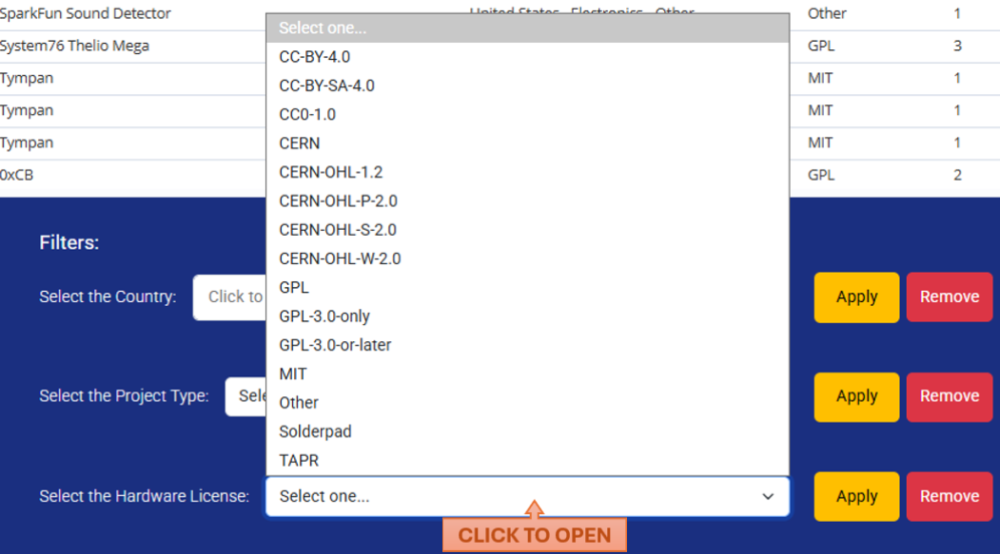

For example, by selecting the *MIT* hardware license type, and clicking the *Apply* button:

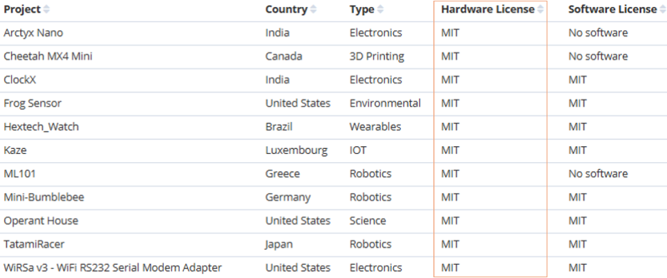

Finally, and as in the previous cases, to clean the filter just click the *Remove* button.

##### Filtering by Software License

This filter allows to select a software license from a drop-down list and view the result on a data table dashboard. The following table contains all the available software
licenses:

- Apache

- CC-BY-4.0

- CC-BY-SA-4.0

- CC0-1.0

- CERN-OHL-P-2.0

- CERN-OHL-S-2.0

- CERN-OHL-W-2.0

- GPL

- GPL-3.0-only

- GPL-3.0-or-later

- LGPL

- MIT

- Mozilla

- No software

- Other

Again, this list is extracted from the only dashboard including this filter.

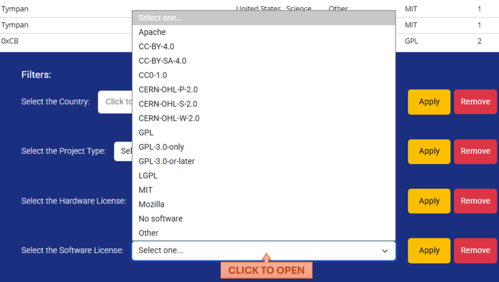

For example, by selecting the *Mozilla* hardware license type, and clicking the *Apply* button:

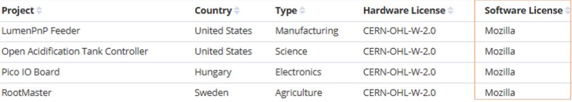

### Saving a Dashboard

All dashboard display screens have a *Save* button at the bottom right:

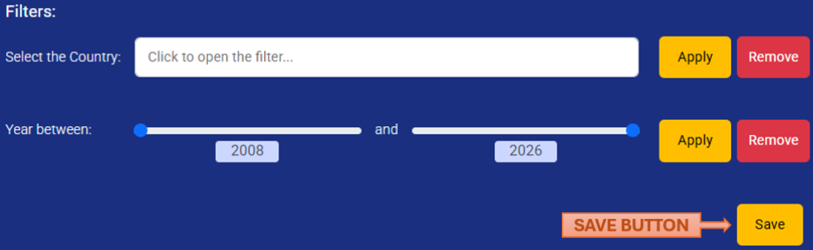

The dashboard is saved as an HTML file with a very simple format. It contains only the title and the embedded chart, and it can be opened with any browser.

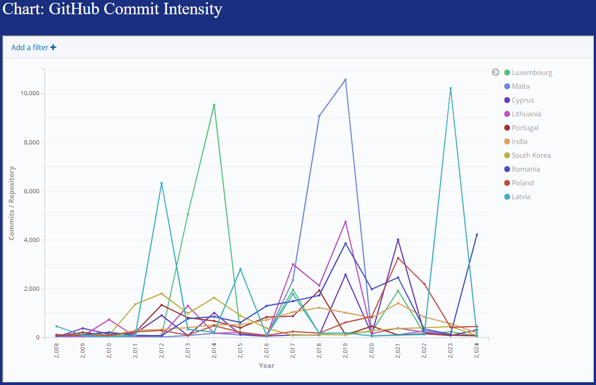

If filters have been applied prior to saving, they are also exported. For example, filtering by:

- Country: Latvia, Lithuania, Luxembourg and Malta.

- Year: 2015 – 2023

The dashboard is saved as:

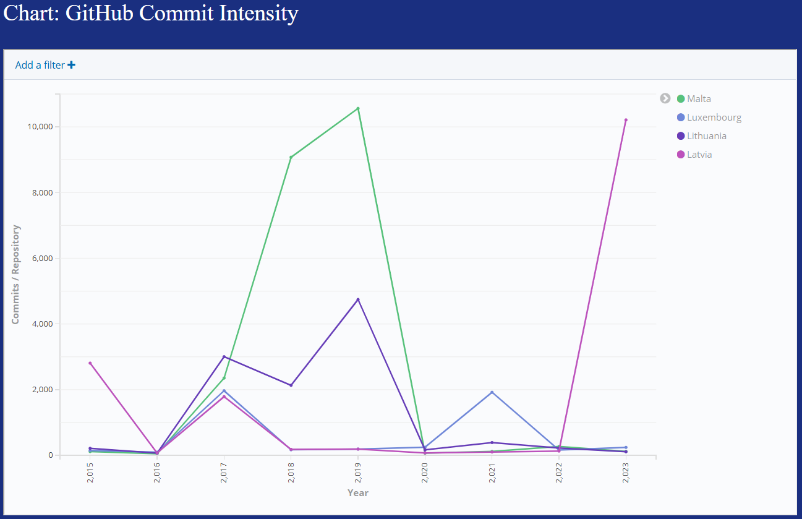

### Consult User Stories

The User Stories display screen shows the list of successful shared stories (if any) about
projects, actors..., which contain the following information:

- **Date**: when the story has been published.

- **Description**: a short description of the story.

- **Link**: the website where the story can be read. Clicking the *Read Story* button opens a new browser window containing the content of the linked story.

The following figure shows a couple of examples of User Stories:

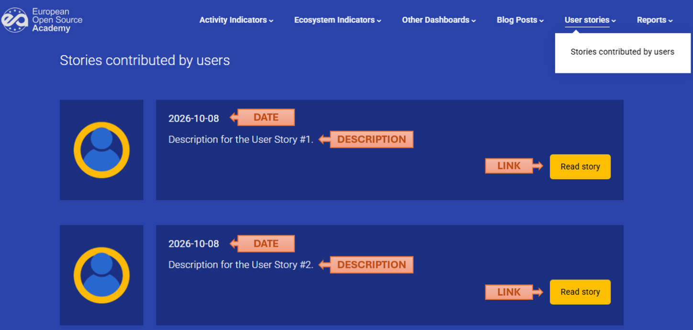

### Consult Reports

The Reports display screen shows the list of generated reports (if any), which contain the following information:

- **Date**: when the report has been published.

- **Title**: the name or title of the report.

- **Description**: a brief description of the report.

- **Link**: the website where the report can be viewed or downloaded. Clicking the *View/Download report* button opens a new browser window containing the content of the report.

The following figure shows two examples of available Reports:

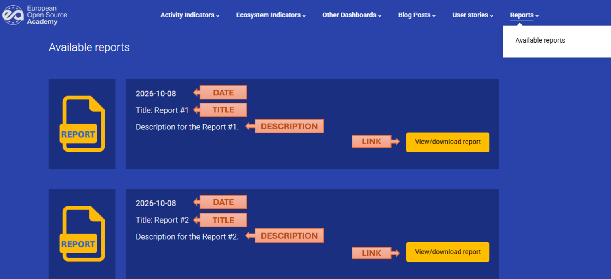